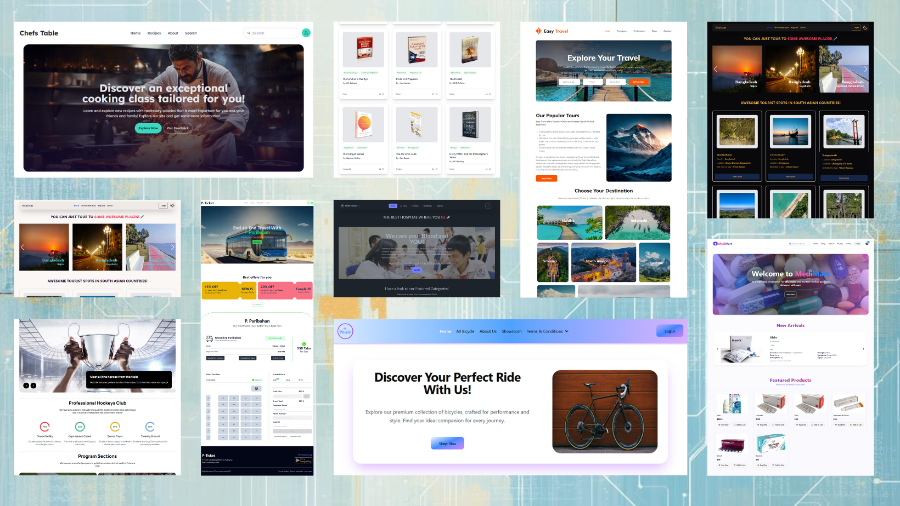

<!--  -->

  

# Hi, I'm Margon 👋

### MERN Stack | Next.js | Nest.js | React Developer

I'm a web developer who enjoys building practical, user-friendly web applications. I work primarily with JavaScript, TypeScript, React, Next.js, Node.js, Nest.js and MongoDB. Coding gives me joy, and I love to learn, know, and work more about it.

 

<!--
**Marg0n/Marg0n** is a ✨ _special_ ✨ repository because its `README.md` (this file) appears on your GitHub profile.

Here are some ideas to get you started:

- 🔭 I’m currently working on ...
- 🌱 I’m currently learning ...
- 👯 I’m looking to collaborate on ...
- 🤔 I’m looking for help with ...
- 💬 Ask me about ...
- 📫 How to reach me: ...
- 😄 Pronouns: ...
- ⚡ Fun fact: ...
-->

## About Me!

- 🔭 I’m currently working at [The Christian Co-operative Credit Union Ltd., Dhaka](https://cccul.com/)
- 🌱 I’m contenously learning more about the MERN stack, Nest.js, Next.js, postgreSQL and Flutter
- 📫 You can reach me by email [monondcosta@gmail.com](mailto:monondcosta@gmail.com)

 

## 💻 Technologies I Code With

<table>
  <tr>
    <td align="center" width="160">
      <strong>🎨 Frontend</strong>
    </td>
    <td>
      
      
      
      
    </td>
  </tr>
  <tr>
    <td align="center">
      <strong>⚛️ Languages & Frameworks</strong>
    </td>
    <td>
      
      
      
      
      
    </td>
  </tr>
  <tr>
    <td align="center">
      <strong>⚙️ Backend</strong>
    </td>
    <td>
      
      
      
      
    </td>
  </tr>
  <tr>
    <td align="center">
      <strong>🗄️ Database & ORM</strong>
    </td>
    <td>
      
      
      
      
    </td>
  </tr>
</table>
 

## 🚀 Featured Projects

### Full Stack Projects

<table>
  <tr>
    <td align="center" width="50%">
      
    </td>
    <td align="center" width="50%">
      
    </td>
  </tr>
</table>

### Backend Projects

<table>
  <tr>
    <td align="center" width="50%">
      
    </td>
    <td align="center" width="50%">
      
    </td>
  </tr>
  <tr>
    <td align="center" width="50%">
      
    </td>
    <td width="50%"></td>
  </tr>
</table>

### Ongoing Projects

<table>
  <tr>
    <td align="center" width="50%">
      
    </td>
    <td align="center" width="50%">
      
    </td>
  </tr>
</table>
 

## :bar_chart: My Stats Summary

  

## :chart_with_upwards_trend: Current Streak Stats

 

  <!--  -->
  <!--  -->
  <!--  -->
  
  <!-- 
  
  
   -->
  
  <!--  -->

 

## :technologist: Most Used Languages:

    <!--  -->
    <!--  -->
    

 

## 🏆 Trophy Stats:

  
    <!--  -->
    <!--  -->
    <!--   -->
     
    

 

## 🧮 Profile View Count (from Aug '25):

 
    <!--   -->  

  <!-- 👤 GitHub Profile Views
  <!-- GitHub profile views -->
  <!--  
  
    

  📦 Repository Visitors -->
  <!-- Repo visitor count -->
  

